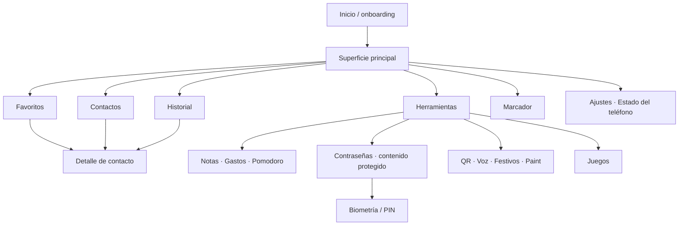
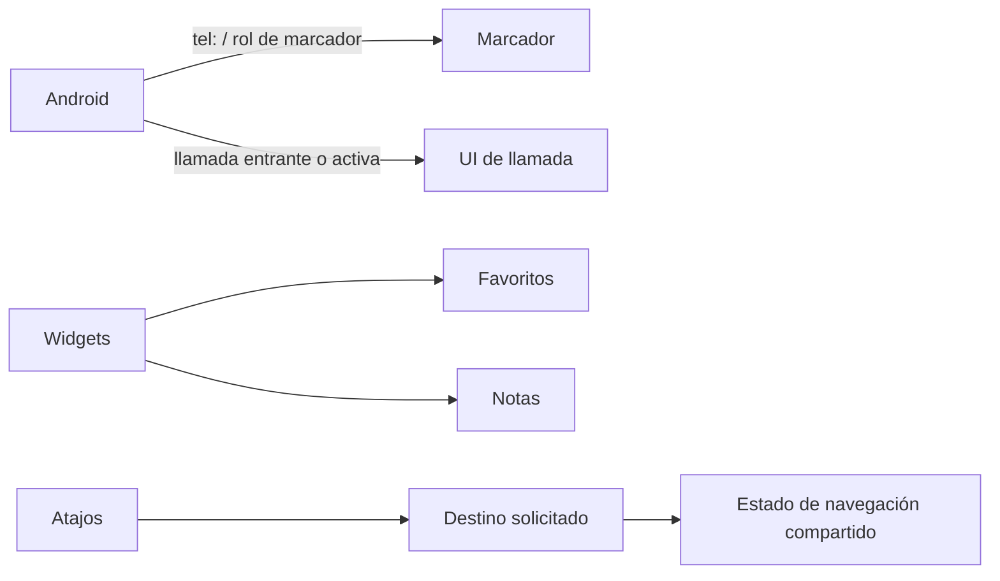

# Sistema de diseño de Fun Phone

Este documento define el sistema UI/UX de Fun Phone. Es una referencia viva y normativa para
diseñar, implementar y revisar nuevas experiencias en la aplicación. Describe la interfaz actual y
establece los contratos que deben conservar su coherencia, accesibilidad y carácter local-first.

Para requisitos de producto consulta [PRD.md](PRD.md); para gates verificables de accesibilidad,
adaptabilidad y rendimiento consulta [QUALITY_RELEASE_GATES.md](QUALITY_RELEASE_GATES.md).

## 1. Principios de experiencia

### Privacidad visible, no implícita

- Los datos personales permanecen en el dispositivo y la interfaz no debe sugerir sincronización o
  respaldo remoto cuando no existen.
- Las funciones con acceso a contactos, llamadas, calendario, cámara, micrófono o red explican el
  propósito antes de solicitar acceso.
- Las rutas de red de festivos y preview social/web se activan por una acción explícita del usuario;
  sus límites y destinos se documentan en `PRIVACY_DATA_FLOW.md`.
- Ningún estado, texto, captura o log de UI debe revelar contraseñas, notas protegidas, números o
  datos personales innecesarios.

### Claridad antes que densidad

- Cada pantalla debe tener una acción principal reconocible y una jerarquía visual inequívoca.
- Las acciones secundarias se agrupan en barras, menús o superficies consistentes; no compiten con
  la tarea principal.
- Los estados del sistema se expresan con texto y semántica, además de color o iconos.
- La personalización nunca debe reducir legibilidad, contraste, tamaño táctil o comprensión.

### Integración Android predecible

- Los permisos se solicitan en contexto y siempre ofrecen una ruta de recuperación.
- Las acciones de Telecom, Contacts Provider, Calendar y Sharesheet respetan los patrones del
  sistema y no simulan capacidades ausentes.
- Back cierra primero la superficie transitoria o destino secundario actual y solo después abandona
  el flujo principal.

### Accesibilidad como requisito funcional

- TalkBack, texto grande, orientación horizontal y pantallas amplias forman parte del contrato de
  cada flujo, no son mejoras opcionales.
- Toda acción debe seguir siendo comprensible sin color, animación, sonido o vibración.
- Las preferencias de movimiento, fuente, escala y hápticos del usuario se respetan en todas las
  superficies que las consumen.

## 2. Arquitectura de información

La experiencia principal se organiza en cuatro pestañas dentro de un `HorizontalPager`. Los flujos
de detalle y herramientas se abren como destinos secundarios administrados por
`NavigationViewModel` y `SecondaryScreen`.

Las superficies del sistema pueden entrar sin recorrer la navegación principal. Deben restaurar el
contexto correcto y ofrecer una salida clara.

El onboarding tiene dos pasos: una bienvenida breve y una configuración guiada. La bienvenida
explica que las herramientas son opcionales y conserva los presets de herramientas (incluido el
modo personalizado) para elegirlas desde el primer uso; la misma selección permanece disponible
en Ajustes. La configuración incluye el acceso de alarmas exactas que necesitan los recordatorios
de cumpleaños, junto con el rol de teléfono, notificaciones y permisos de llamadas. Cada acción se
inicia con una pulsación explícita; si se pospone, la misma capacidad se recupera desde Estado del
teléfono sin ocultar los contactos ni mostrar un diálogo automático al entrar en la pantalla
principal.

### Contrato de navegación

- `NavigationItem` define exclusivamente las cuatro pestañas principales.
- `SecondaryScreen` representa destinos secundarios y debe actualizarse junto con su renderizado y
  sus pruebas cuando se agregue una ruta.
- Las pestañas conservan su posición de scroll y selección al abrir y cerrar destinos secundarios.
- Los deep links, widgets y atajos convergen en el mismo estado de navegación; no deben crear una
  segunda jerarquía paralela.
- Una pantalla secundaria usa `SecondaryTopBar` o un patrón equivalente con acción Back localizada.
- `NavigationViewModel` conserva una pila ligera de rutas secundarias y la dirección de transición.
  La flecha y Back usan `navigateBack`; guardar reemplaza el editor mediante `replaceSecondary`.
  Telecom conserva su cierre especial al destino principal. Se restauran rutas, identificadores y
  offsets; los datos de contactos o notas se vuelven a resolver, sin guardarlos en el estado de navegación.

## 3. Fundamentos visuales

La implementación canónica vive en
`core/designsystem/src/main/java/com/bookverse/contacts/ui/theme/ContactsAppTheme.kt`. Los nombres y valores de
este documento describen esa implementación; el código sigue siendo la fuente de verdad ejecutable.

### Color

Fun Phone ofrece cuatro esquemas de superficie:

| Esquema | Fondo | Superficie | Uso |
| --- | --- | --- | --- |
| Claro | gris azulado muy claro | blanco | experiencia diurna de alto contraste |
| AMOLED | negro | gris carbón | modo oscuro con fondo negro real |
| Gris oscuro | gris profundo | gris elevado | alternativa oscura con separación tonal |
| Dim | gris medio oscuro | gris aclarado | menor contraste luminoso sin perder legibilidad |

El color de acento es personalizable y funciona como semilla, no como color plano de uso universal.
`ContactsAppTheme` deriva roles contrastados y un container suave para que la preferencia permanezca
visible sin competir con el contenido. `MaterialTheme.colorScheme` es la API predeterminada para
fondos, superficies, contenido, contornos y estados.

La jerarquía es neutral-first: cards, headers, iconos decorativos, listas y acciones secundarias
usan roles de superficie; selección e indicadores usan `primaryContainer`/`onPrimaryContainer`; y
`primary`/`onPrimary` se reservan para la acción principal, foco y anclajes pequeños de identidad.
El color semilla exacto solo se usa en el selector y en barras Retro elegidas explícitamente.

Los colores funcionales existentes —aceptar/rechazar/finalizar llamadas, errores, badges y estados
de presupuesto— son tokens semánticos. Un color específico de dominio solo se añade al tema cuando
su significado es estable y reutilizable.

Reglas:

- No introducir `Color(0x...)` en pantallas o componentes si existe un token semántico equivalente.
- Consumir los roles derivados del tema; no recolectar ni propagar la semilla desde cada pantalla.
- No crear containers con `primary.copy(alpha = ...)`; usar `primaryContainer` para selección y
  superficies teñidas.
- Resolver el color de contenido con el par correspondiente (`onPrimary`, `onPrimaryContainer`) o
  una decisión explícita de contraste.
- Combinar error, éxito, alerta o selección con texto, forma, icono o semántica.
- Verificar estados normal, pressed, disabled, selected y focused en claro y en los tres modos
  oscuros.
- Los scrims deben conservar el foco visual y no ocultar información indispensable.

### Tipografía

`ContactsAppTheme` conserva la escala completa de Material 3 y aplica la familia seleccionada a
todos los roles tipográficos. `Fonts.kt` contiene las familias disponibles y es el catálogo
ejecutable.

- Usar roles de `MaterialTheme.typography`; evitar tamaños aislados salvo componentes de identidad
  ya establecidos.
- Mantener una jerarquía consistente: títulos para contexto, body para contenido y labels para
  controles o metadatos.
- La escala configurada por el usuario multiplica la escala del sistema; ninguna pantalla puede
  asumir `fontScale == 1.0`.
- Las fuentes decorativas no justifican truncar acciones, reducir targets ni forzar una sola línea.
- Números críticos —teléfono, temporizadores, puntuaciones— deben priorizar legibilidad y alineación
  sobre ornamentación.

### Espacio, forma y elevación

- Partir de la escala y shapes de Material 3 y del ritmo ya usado por componentes compartidos.
- Usar espaciado consistente entre elementos equivalentes; evitar offsets negativos o valores
  arbitrarios para corregir una pantalla concreta.
- Las superficies elevadas comunican agrupación, selección o modalidad. No añadir sombra solo como
  decoración.
- Respetar edge-to-edge, `WindowInsets` y áreas del sistema. El contenido primario no puede quedar
  bajo barras, cutouts o navegación gestual.
- Preferir layouts fluidos con `weight`, restricciones o grids adaptables frente a anchos y alturas
  fijos.

### Iconografía

- Reutilizar primero Lucide y Material Icons ya incluidos.
- Un icono accionable requiere descripción localizada o semántica equivalente. Los iconos
  puramente decorativos usan `contentDescription = null`.
- No mezclar estilos visuales dentro del mismo grupo de acciones.
- Las acciones críticas no se representan únicamente con un símbolo ambiguo; deben incluir texto,
  tooltip, diálogo o contexto suficiente.

## 4. Componentes y patrones

Antes de crear una variante, revisar `ui/components/` y las implementaciones de pantallas similares.
La duplicación visual debe resolverse ampliando un componente compartido cuando el comportamiento
sea realmente común.

| Patrón | Referencia | Contrato principal |
| --- | --- | --- |
| Barra principal | `MainTopBar` | título, conteo y acciones coherentes con el estilo de acento |
| Barra secundaria | `SecondaryTopBar` | Back localizado, título por estilo y acciones contextuales |
| Acciones de barra | `ActionPillScope` y top-bar pills | targets accesibles y contraste sobre acento/superficie |
| Navegación principal | `MainTabNavigationBar` | cuatro destinos, selección visible y labels localizados |
| Feedback breve | `AppSnackbarHost` / `AppSnackbarState` | mensaje accionable, no bloqueante y sin datos sensibles |
| Permisos | `PermissionBanner` / `PermissionRationaleDialog` | propósito, consecuencia y ruta de recuperación |
| Confirmación | `ConfirmDialog` | verbo específico y énfasis correcto para acción destructiva |
| Selección | chips, badges y barras de filtro | estado anunciado y no dependiente solo del color |
| Contenido agrupado | cards, listas y grids compartidos | jerarquía, keys estables y comportamiento con texto grande |
| Autenticación | diálogos biométricos y PIN | no filtrar contenido antes del éxito ni conservarlo visible |

### Barras y acciones

- Usar `MainTopBar` en las pestañas y `SecondaryTopBar` en destinos con regreso.
- El estilo Retro usa la semilla como contenedor; el estilo minimal usa fondo y pills de superficie.
- Moderno usa títulos al inicio, sin cápsulas. Las superficies de consulta usan la variante
  expandible; formularios, marcador, juegos y superficies interactivas usan una barra compacta fija.
  La búsqueda y la selección permanecen fijas. La flecha resuelve primero el teclado y después la búsqueda.
- Limitar las acciones visibles a las más frecuentes. El resto va a overflow o a una superficie
  contextual.
- El título no debe desaparecer para acomodar acciones; con texto grande se permite reflujo,
  reducción de densidad o traslado de acciones.

La expansión responde a la tarea de cada destino, no a la mera presencia de scroll:

| Tipo de tarea y destinos | Encabezado Moderno | Motivo |
| --- | --- | --- |
| Explorar: Contactos, Favoritos, Historial, Herramientas, catálogo de Juegos | Compacto inicial, expandible al tirar desde el inicio | Acercar título y acciones sin quitar espacio al recorrer contenido. |
| Consultar: detalle de contacto, perfil, Ajustes, Estado del teléfono, Acerca de, gastos y calendarios | Compacto inicial, expandible | Mantener continuidad con las listas y facilitar el acceso a las acciones de consulta. |
| Administrar listas: notas, contraseñas, carpetas, papeleras, etiquetas y duplicados | Compacto inicial, expandible; fijo durante búsqueda/selección cuando aplique | Recorrer colecciones conservando las acciones contextuales estables. |
| Ordenar herramientas | Compacto inicial, expandible durante scroll; inmóvil durante el arrastre de una herramienta | Es también un catálogo largo de presets y visibilidad. El arrastre no debe desplazar los destinos de colocación. |
| Crear/editar contacto o perfil, Nota, Checklist, contraseña, recordatorio y grabación | Compacto fijo | Priorizar campos, teclado, selección de texto y acciones de edición sin moverlos al cambiar de dirección. |
| Ordenar favoritos | Compacto fijo | La tarea principal es colocar tarjetas en una cuadrícula; mantener referencias espaciales estables. |
| Marcador, QR, voz, Pomodoro, Paint, collage y partidas | Compacto fijo | Reservar espacio y estabilidad para entrada, cámara, lienzo o controles interactivos. |

Una pantalla expandible conecta su scroll real y su barra al mismo comportamiento y conserva
offsets por destino. Las ventanas bajas mantienen la barra compacta. El detalle de contacto usa
un título genérico localizado; el nombre pertenece al contenido de identidad, no al encabezado.
Su sección de origen solo aparece cuando hay cuentas visibles. Una lista nula, vacía o compuesta
solo por cuentas excluidas no muestra un selector vacío; el contador y la hoja comparten la misma
lista filtrada y sin duplicados.

### Listas, grids y formularios

- Los elementos lazy usan keys estables cuando representan datos durables.
- Empty, loading y error ocupan la región de contenido y mantienen disponible la navegación.
- Los formularios muestran labels persistentes, errores cercanos al campo y una acción de envío
  inequívoca.
- El teclado, selección de texto y autofill no deben romper acciones nativas esperadas.
- Los grids deben responder al ancho disponible; el número configurable de columnas nunca puede
  producir targets ilegibles o inaccesibles.

### Diálogos, sheets y feedback

- Un diálogo se reserva para decisiones bloqueantes, autenticación o confirmación de riesgo.
- Un snackbar comunica resultados recuperables o confirmaciones breves.
- No apilar diálogos. Cerrar o resolver la superficie actual antes de presentar la siguiente.
- Los errores explican qué ocurrió y qué puede hacer la persona; evitar códigos internos como copy
  principal.
- Toda acción destructiva nombra el objeto afectado y distingue claramente cancelar de confirmar.

## 5. Estados de experiencia

Las pantallas con datos asíncronos o durables representan explícitamente los estados aplicables:

| Estado | Comportamiento esperado |
| --- | --- |
| Loading | mantiene estructura estable y evita acciones sobre datos incompletos |
| Empty | explica el estado y ofrece la siguiente acción pertinente |
| Content | prioriza la tarea principal y conserva selección/scroll cuando corresponda |
| Recoverable error | informa, permite reintentar o cambiar configuración y conserva datos válidos |
| Limited mode | explica la capacidad ausente sin convertir el permiso en una pantalla bloqueante |
| Locked | oculta datos protegidos hasta completar biometría o PIN |
| Offline | diferencia contenido cacheado, ausencia de red y función no habilitada |

Los eventos transitorios —navegación, mensajes y solicitudes de permiso— no deben persistirse como
estado durable consumible varias veces. Sigue el contrato de estado y efectos descrito en
`QUALITY_RELEASE_GATES.md`.

## 6. Interacción, movimiento y hápticos

- Las transiciones expresan continuidad entre pestañas, destinos y estados; no retrasan una acción
  crítica ni bloquean input.
- Respetar `AnimationSpeed`, `TransitionType` y las preferencias de vibración disponibles en
  `AppSettingsViewModel`.
- La vibración refuerza una acción, nunca sustituye feedback visual o semántico.
- Acciones irreversibles requieren confirmación o una reversión explícita cuando sea viable.
- Deshabilitar un control debe incluir una razón detectable por el usuario cuando no sea obvia.
- Las llamadas entrantes y activas priorizan legibilidad, targets grandes y respuesta inmediata por
  encima de animaciones decorativas.

## 7. Accesibilidad y layouts adaptables

Los gates completos están en `QUALITY_RELEASE_GATES.md`. Como mínimo, toda pantalla nueva o
modificada debe cumplir:

- targets accionables de al menos 48 dp;
- acción principal usable con escala de fuente del 200 %;
- labels localizados, roles y estados correctos para TalkBack;
- orden de foco equivalente al orden de lectura visual;
- contraste verificable en claro y oscuro;
- información de estado expresada por más de un canal;
- soporte de portrait, landscape y split screen sin perder acciones;
- soporte de anchos compactos, medios de 600–839 dp y expandidos de 840 dp o más;
- ausencia de contenido atrapado bajo system bars o fuera del viewport.

Las capturas de `screenshots/` ilustran la aplicación publicada, pero no son especificaciones
normativas. El código, este sistema de diseño y los gates de calidad prevalecen si una captura queda
desactualizada.

## 8. Localización y contenido

- El baseline de copy es `values/strings.xml` en inglés; español, alemán, francés y portugués deben
  conservar paridad de claves, plurales, arrays y placeholders.
- No hardcodear texto visible en Kotlin.
- Redactar títulos breves, botones con verbos concretos y errores orientados a recuperación.
- Fechas, horas, números, monedas y plurales usan formatters y recursos localizados.
- Diseñar con la traducción más larga: una interfaz válida solo en inglés no está terminada.
- El tono es directo, respetuoso y calmado, especialmente en permisos, fallos, seguridad y llamadas.

## 9. Checklist de contribución UI/UX

### Antes de implementar

- [ ] La necesidad y la acción principal están definidas.
- [ ] Se revisaron componentes y pantallas equivalentes.
- [ ] Se identificaron estados, permisos, contenido protegido y rutas de recuperación.
- [ ] La solución contempla texto grande, TalkBack y anchos compact/medium/expanded.

### Durante la implementación

- [ ] Se usan tokens semánticos, tipografía y componentes compartidos.
- [ ] El estado tiene un único propietario y los efectos transitorios no son durables.
- [ ] Todos los textos y descripciones accionables están localizados.
- [ ] Back, teclado, system bars, selección y rotación mantienen un comportamiento predecible.
- [ ] Los datos sensibles permanecen ocultos antes de autenticar y no aparecen en logs.

### Antes de entregar

- [ ] Se revisaron claro, AMOLED, gris oscuro y dim cuando el cambio usa color o superficies.
- [ ] Se verificaron estados loading, empty, content, error y limited/locked aplicables.
- [ ] La acción principal funciona con TalkBack y texto al 200 %.
- [ ] Se ejecutaron los gates proporcionales de `AGENTS.md` y `QUALITY_RELEASE_GATES.md`.
- [ ] La entrega documenta pruebas realizadas, riesgos y validaciones manuales pendientes.

## 10. Mantenimiento del sistema

- Actualiza este documento en el mismo cambio que introduzca un patrón visual, token o contrato de
  interacción nuevo.
- No registres aquí números de versión de la aplicación o dependencias volátiles; referencia sus
  fuentes ejecutables.
- Una excepción de diseño debe incluir motivo, alcance y criterio para no propagarse como patrón.
- Cuando documentación y comportamiento difieran, verifica primero el código y los gates; corrige
  el documento o la implementación dentro del mismo cambio según cuál represente la decisión
  vigente.

## Upgrade contract — 2026-11-03

Surfaces use neutral container roles across all four themes. AMOLED pairs true black with
`#2C2C2E` cards; dark-gray and Dim preserve increasing luminance without the previous blue cast.
`surfaceContainerLowest/Low/High/Highest`, outlines and content roles are derived together and
covered by contrast checks. User-selected accents and fonts remain intact.

## Contrato Moderno — 2026-11-08

`AccentBarStyle.MODERN` es el valor inicial. `ModernAppearanceMigration` lo activa una sola vez,
en la misma transacción DataStore que su marca local, antes de mostrar la interfaz principal.
La migración conserva las demás preferencias. Elegir un estilo o importar preferencias marca la
migración como aplicada; la elección no se vuelve a sobrescribir. El backup conserva los tres
estilos, las semillas nuevas, el color personalizado y la variante oscura.

`AppChrome` centraliza medidas y `LocalAppChromeStyle` coordina tema, barras, controles y dock.
`AppScreenScaffold` posee el backdrop de cada destino secundario; en las pestañas comparte el estado
de `MainNavigationScaffold` para que encabezado y dock reutilicen una sola captura del contenido.
La fuente de captura contiene únicamente el contenido detrás de las barras. Los controles y
títulos se dibujan fuera del efecto. El contenedor raíz de navegación no captura destinos secundarios.
La fuente incluye el color base del `Scaffold`: el espacio vacío conserva el fondo real al
desenfocarse, sin convertirse en el blanco del material de las barras.
La implementación Haze y Activity se fijan en `gradle/libs.versions.toml`, sin cambiar Kotlin ni BOM.
Android 12+ usa blur de 16 dp con reducción automática de resolución del fondo; el texto y los
iconos mantienen su resolución. Ajustes › Efectos de cristal decide cuánto se usa. Automático (por
defecto) da blur y refracción a equipos que declaran clase de rendimiento multimedia 12 o superior;
en gama media (≥ 6 GB de RAM, unos 5 GB reportados) deja solo el blur, porque la refracción añade
otra capa por superficie que no cabe a 120 Hz; por debajo usa la superficie sólida. Activados fuerza
blur y refracción en Android 12+ y Desactivados lo apaga. Android 10–11, ahorro de batería,
dispositivos de poca memoria y editores protegidos/cámara/juegos usan siempre una superficie tonal
sólida. La preferencia es local del dispositivo y no viaja en la copia de ajustes. Notas, la lista de Contraseñas
y Gastos comparten el backdrop real de las pestañas. Los listeners y capas se liberan al abandonar
su composición, y el backdrop se descarta cuando la ventana deja de estar visible. El acceso
autenticado y `FLAG_SECURE` siguen perteneciendo a `ProtectedScreenHost`, no a la política visual.
Las llamadas conservan sus superficies y contratos Telecom.

`rememberAppBarScrollBehavior` inicia Moderno compacto en cada destino nuevo y conecta directamente
el scroll con el título. Solo se amplía al arrastrar hacia abajo desde el principio del contenido;
arrastrar la propia barra no cambia su altura. Cada estilo conserva sus offsets independientemente.
El título, contador, Atrás y acciones comparten una fila que baja al expandirse; no quedan iconos
aislados junto a la barra de estado. La tipografía interpola sus roles sin duplicar el título.
Las pantallas con búsqueda declaran `AppBarSearchAction`: Moderno muestra una barra completa debajo
de esa fila y los otros estilos mantienen la acción de lupa. La barra acompaña directamente el
scroll. Al activarla, el encabezado se compacta con la velocidad elegida y la búsqueda queda fija;
al cerrarla recupera su expansión anterior. El texto y el foco siguen siendo propiedad del destino.
Los campos y sus previews usan roles semánticos y altura adaptable, con targets de al menos 48 dp.
Las búsquedas Modernas comparten `SearchFieldSurface` tanto en reposo como durante la edición:
cristal neutro, reflejos que se desvanecen entre tramos y texto/iconos nítidos. Se aplica a Contactos, Historial,
Notas, Contraseñas, Checklist, Ajustes y los selectores de favoritos, etiquetas y marcación rápida.
Los diálogos conservan el acabado sólido con brillo; no capturan el fondo de otra ventana.
En ventanas de menos de 480 dp de alto usa la barra compacta para reservar espacio al contenido. La variante compacta
no consume desplazamientos del formulario. `AppBarStateRegistry` conserva solo offsets de barras
y listas por ruta/carpeta; nunca guarda contenido de formularios. Las cuatro pestañas conservan
sus estados al volver desde un detalle. `MainTabPagerSync` coordina el toque y el swipe con el
indicador del dock. Las transiciones conservan sus tipos, invierten la dirección al volver y
respetan la velocidad elegida y la escala de animaciones del sistema.

El dock tiene márgenes de 16 dp, ancho máximo de 560 dp, forma de cápsula y altura según el texto.
`LiquidGlassSurface` reutiliza el backdrop con blur de 10 dp, reflejos direccionales y sombra discreta.
Los reflejos se concentran en dos zonas opuestas y desaparecen entre ellas; nunca dibujan un aro
uniforme ni un segundo círculo interior. Dock, FAB y búsquedas comparten este material. Las topbars
usan su variante de ancho completo, con blur de 16 dp y un reflejo tenue en el borde inferior.
El cristal flotante claro usa `surfaceContainerHigh` con menos tinte y una absorción tonal amplia;
la reflexión y el volumen siguen siendo visibles sobre fondos uniformes, incluso blancos. Ese
acabado se aplica también al fallback sólido y mantiene los controles fuera de la capa óptica.
Las listas de Notas, Contraseñas y el inicio de Gastos desplazan contenido por detrás del encabezado.
Los filtros, progreso de operaciones y secciones permanecen fijos en `topBarFooter`.
En Android 13+ un shader AGSL refracta únicamente el fondo en los bordes; iconos y nombres quedan
fuera de esa capa. Android 12 conserva blur y reflejos. Las condiciones de fallback mantienen una
superficie sólida y desactivan la refracción. El shader se compila una vez por superficie y sus
uniforms solo cambian con el tamaño/densidad; no existe una animación ambiental permanente.
La selección mantiene una cápsula de cristal neutro que se desplaza y estira ligeramente con el
progreso del pager. El icono y el texto seleccionados usan `primary`, derivado del acento elegido;
sobre cristal claro se profundiza hacia `onSurface` para mantener el contraste con la lente y la absorción óptica,
y los inactivos usan `onSurfaceVariant`; el color sigue directamente el progreso del swipe.
El estado seleccionado también se anuncia mediante semántica Tab y texto en negrita. La respuesta
al toque y al foco se recorta a la cápsula de cada opción para evitar contornos rectangulares.
El marcador aparece separado por encima. Su FAB Moderno
es circular de 64 dp, usa cristal neutro con icono nítido y reduce suavemente su escala al pulsarlo.
`ModernFloatingActionButton` también sirve a las acciones de creación compartidas.
Inicio, Notas, Contraseñas y Gastos usan este mismo FAB, con el cristal y reflejos parciales del dock,
sin aro uniforme ni lente circular interior. La lente de selección queda reservada al dock y usa
un relleno tonal sin contorno propio.
El icono permanece nítido fuera de la capa óptica. Los menús flotantes de Notas y Contraseñas se dibujan en `contentOverlay`
de `AppScreenScaffold`, como hermanos del contenido capturado. Nunca forman parte de su propia
fuente de blur. La lista de Contraseñas y los Gastos bloqueados crean esa fuente únicamente dentro
del contenido autenticado; al bloquearse se elimina la composición y su capa óptica. Los editores
protegidos y las demás rutas excluidas conservan la superficie sólida con reflejos, incluso si
heredan una captura de un contenedor superior.
`DialerFloatingActionButton` comparte las tres variantes entre la pantalla principal y el preview:
Moderno conserva el cristal de 64 dp; Minimal usa un círculo de 56 dp, superficie neutra, icono
`onSurface` y borde; Retro conserva el FAB Material con acento. El espacio inferior desplazable se
calcula con la altura real del dock y del inset del sistema; con teclado abierto se reserva el inset IME. Los grupos
Modernos usan esquinas de 24 dp y los controles accionables conservan un mínimo de 48 dp.

Apariencia edita un borrador local con una vista previa conjunta y datos ficticios. Solo Aplicar
escribe sus valores en una transacción; Cancelar descarta el borrador. Se conservan las 27 semillas
y se añaden salvia `#748873`, petróleo `#276C76`, terracota `#B76E56`, malva `#9473A6`, arena
`#AA8C62` y grafito `#62666D`. Los roles y contrastes se siguen derivando en `AccentPalette`.
Las 27 fuentes se agrupan por familia y se destacan Sistema, Inter, Manrope, Roboto y Noto Sans.
Inter y Manrope incluyen fuentes variables locales con pesos 400/500/600/700, procedentes de
Google Fonts (directorios `ofl/inter` y `ofl/manrope`); licencias en `assets/font-licenses`.
La escala tipográfica se aplica una sola vez sobre la de Android, sin recrear la navegación.

La revisión en dispositivo se realiza con Appium MCP o ADB. La evidencia de emulador no sustituye
los gates físicos de fluidez, 60/120 Hz y llamadas. El presupuesto p90 ≤ 24 ms permanece vigente.

Los enlaces telefónicos entregan destino e input en una sola actualización de `NavigationViewModel`,
antes de que termine la carga inicial. Los intents nuevos sustituyen el número incluso si el marcador
ya está abierto. Recrear la Activity no vuelve a aplicar el enlace sobre una edición del usuario.
El número vive solo en memoria del ViewModel; el estado guardado conserva únicamente rutas. Abrir
el FAB o un intent DIAL sin datos abre el marcador vacío. Ningún enlace inicia una llamada por sí solo.
El prefijo internacional `+` se conserva al pegar o editar; un número que ya lo incluye no recibe
un segundo prefijo del selector de país. Actualizar el editor desde un enlace deja el cursor al final.

Main lists, grids and Settings scroll behind the status bar when the Minimal app bar collapses.
A translucent gradient protects the system icons in that state. While the app bar is visible,
its background extends through the status inset. Pinned filters have an opaque background.
Retro fills the status inset with the same accent as the app bar, including when it collapses.
The activity sets the system icon contrast. Font scaling is applied once at the activity theme.

The social modal starts with Facebook home; switching platforms loads their home before a user is
entered. A network home is not a selectable profile. Loading, invalid input, provider failure,
retry and external opening are visible states. Headers stay available while modal content scrolls
at large font scales or in landscape.

Protected destinations use immediate session locking and secure window ownership through animated
transitions. Cancelled authentication cannot execute an old pending action. Restorable vault/note
editor state is encrypted and is exposed only after authenticating again.
