<p align="center">
  
</p>

<h1 align="center">Fun Phone</h1>

<p align="center">
  <b>Un marcador privado y personalizable para Android.</b><br>
  Llamadas y contactos primero, con notas, una bóveda de contraseñas cifrada, gastos, herramientas QR y 10 minijuegos opcionales.
</p>

<p align="center">
  <a href="README.md">English</a> · <b>Español</b>
</p>

<p align="center">
  <a href="https://github.com/Moncada25/fun-phone/actions/workflows/android.yml"></a>
  <a href="https://github.com/Moncada25/fun-phone/releases/latest"></a>
  <a href="LICENSE"></a>
  
  
  
  
</p>

<p align="center">
  <a href="https://play.google.com/store/apps/details?id=com.bookverse.contacts"></a>
  <a href="https://apps.obtainium.imranr.dev/redirect?r=obtainium://add/https://github.com/Moncada25/fun-phone">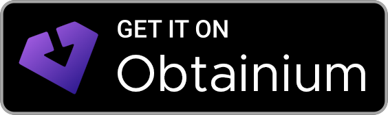</a>
  <a href="https://github.com/Moncada25/fun-phone/releases/latest">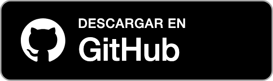</a>
</p>

<p align="center">
  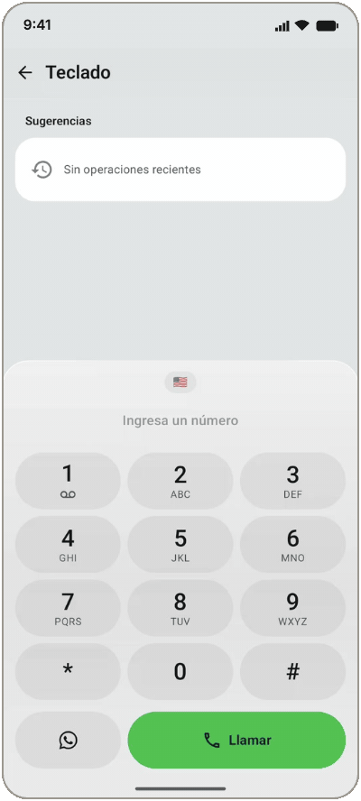
  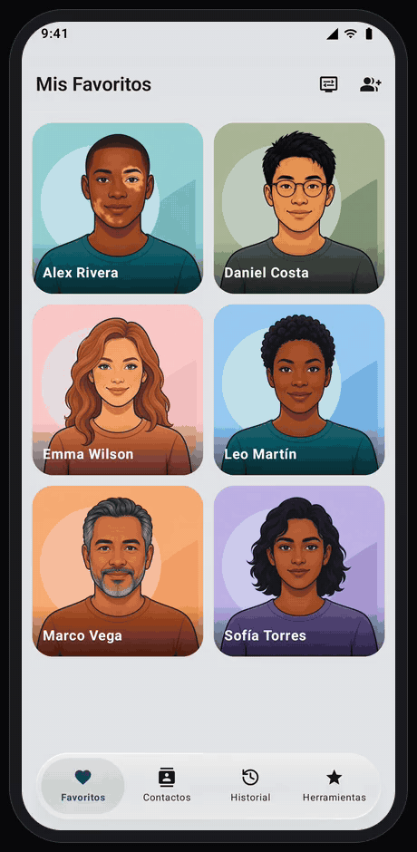
  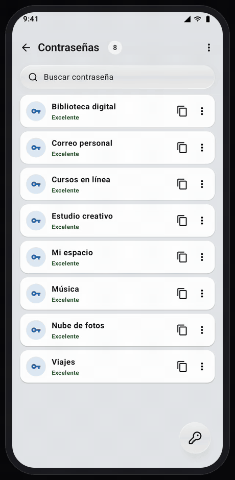
  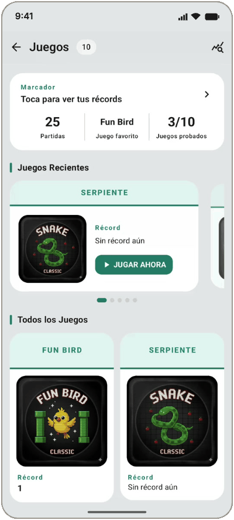
</p>

---

## Por qué Fun Phone

- **Privada por diseño.** Sin anuncios, sin analítica, sin cuenta y sin nube del desarrollador. Tus contactos, notas y contraseñas se quedan en tu teléfono.
- **Una app de teléfono de verdad.** Puede reemplazar el marcador del sistema: búsqueda T9, favoritos, recientes, filtro de llamadas y controles durante la llamada.
- **Solo lo que quieras.** Cada herramienta extra se puede mostrar u ocultar, para que la app sea tan simple como prefieras.
- **A tu manera.** Tres estilos visuales, colores de acento, más de 25 fuentes, tamaño de texto, modo oscuro y efectos de cristal adaptativos.
- **Software libre.** GPL-3.0-or-later, con una versión community sin librerías de Google y con build reproducible.

## Capturas

| Marcador | Favoritos | Llamadas | Notas |
|:---:|:---:|:---:|:---:|
| 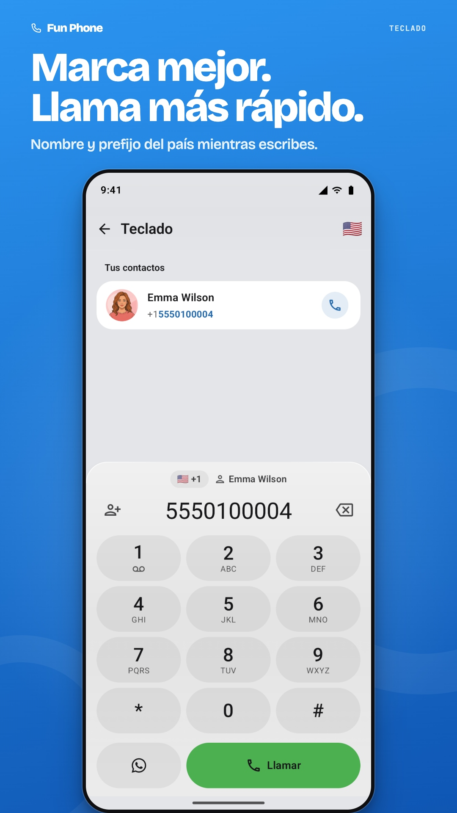 | 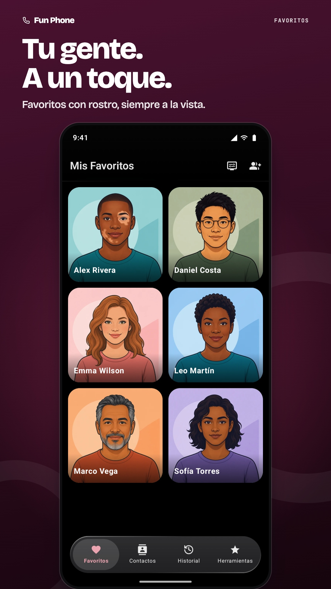 | 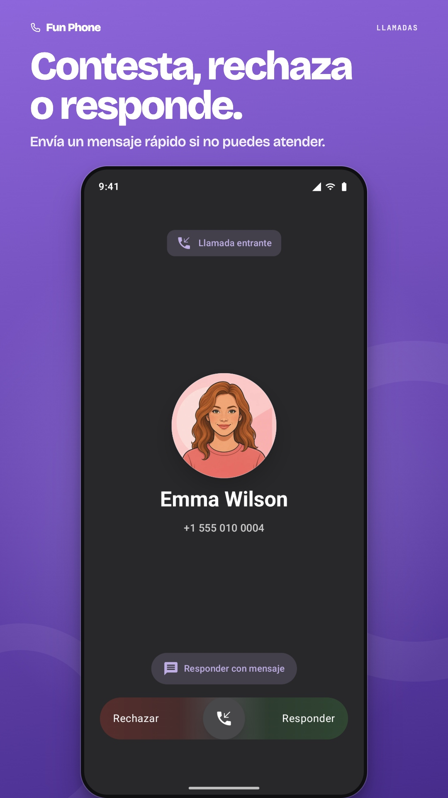 | 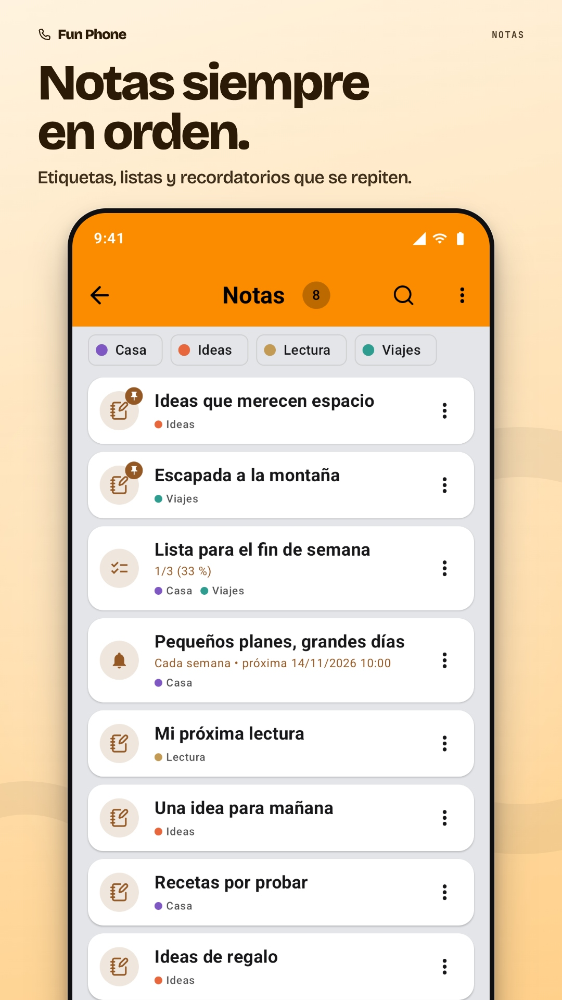 |
| **Bóveda** | **Gastos** | **Herramientas** | **Estilos** |
| 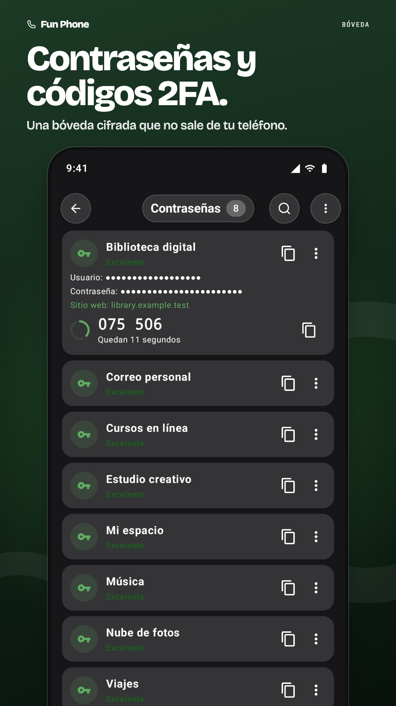 | 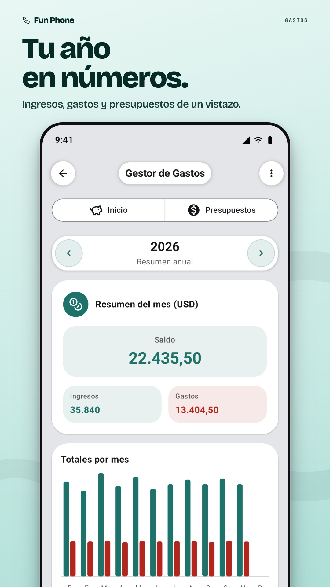 | 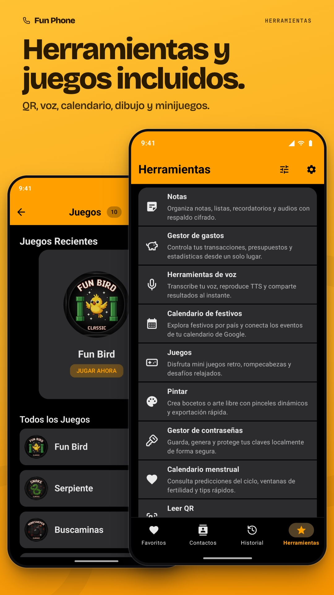 | 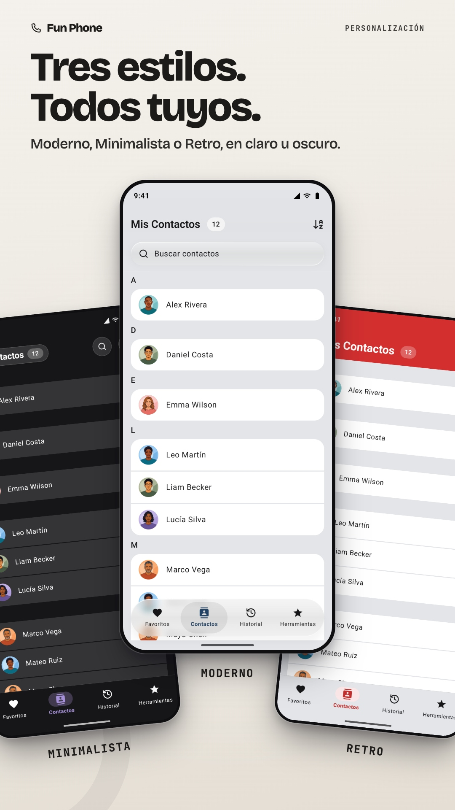 |

Todas las capturas usan datos de demostración ficticios.

## Funciones

<details open>
<summary><b>Llamadas y contactos</b></summary>

- Marcador predeterminado con búsqueda T9, favoritos, recientes y llamadas perdidas.
- Filtro de llamadas y spam en el dispositivo, números bloqueados y respuesta con mensaje.
- Elección de SIM, llamadas en conferencia, espera, tonos del teclado y audio por altavoz o Bluetooth.
- Contactos de tus cuentas de Android, con índice alfabético, etiquetas y favoritos.
- Importación y exportación vCard y JSON, detector de duplicados, papelera y códigos QR de contacto.

</details>

<details>
<summary><b>Herramientas opcionales</b></summary>

- **Notas:** texto enriquecido, listas, etiquetas, imágenes, búsqueda global, recordatorios repetidos, grabaciones de voz y widget en la pantalla de inicio.
- **Bóveda de contraseñas:** cifrada con Tink y el Android Keystore, se desbloquea con PIN o biometría, con generador, códigos de dos pasos (TOTP), aviso de contraseñas repetidas y autocompletado del sistema.
- **Gastos:** movimientos, presupuestos, vistas mensual y anual, filtros y exportación a CSV.
- **QR:** escáner y generador, con códigos Wi-Fi y lectura desde la galería.
- **Voz:** dictado y lectura en voz alta con las voces de tu Android.
- **Calendario:** festivos (opcional, a pedido), cumpleaños de contactos y eventos de los calendarios de tu dispositivo.
- **Además:** Pomodoro, seguimiento del ciclo, estudio de dibujo y 10 minijuegos (Fun Bird, Serpiente, Buscaminas, 2048, Rompecabezas, Tres en Línea, Ahorcadito, Romper Bloques, Sudoku y Cartas de Memoria).

</details>

<details>
<summary><b>Personalización y accesibilidad</b></summary>

- Estilos Moderno, Minimalista y Retro, en claro y oscuro.
- Colores de acento, más de 25 fuentes, tamaño de texto, animaciones y patrones de vibración.
- Efectos de cristal adaptativos según el rendimiento de tu teléfono.
- Etiquetas y navegación pensadas para TalkBack y otros servicios de accesibilidad.
- Disponible en español, inglés, alemán, francés y portugués.

</details>

<details>
<summary><b>Tus datos</b></summary>

- Copia de seguridad completa y cifrada que exportas y guardas tú, y bloqueo de la app.
- Accesos directos a favoritos, recientes y el marcador.

</details>

## Descarga

| | Google Play | GitHub Releases | F-Droid |
|---|---|---|---|
| Paquete | `com.bookverse.contacts` | `com.bookverse.contacts.community` | `com.bookverse.contacts.community` |
| Librerías de Google | ML Kit (QR) e In-App Review | Ninguna | Ninguna |
| Escáner QR | ML Kit | ZXing | ZXing |
| Actualizaciones | Google Play | [Obtainium](https://github.com/ImranR98/Obtainium) o manual | Cliente de F-Droid |
| Estado | Disponible | Disponible | [Solicitud en revisión](https://gitlab.com/fdroid/fdroiddata/-/merge_requests/57835) |

Las versiones de Google Play y community se instalan una al lado de la otra y no comparten datos.
Usa la copia de seguridad de la app para pasar tus datos de una a otra.

### Verifica el APK community

El APK community de GitHub Releases está firmado con este certificado (SHA-256):

```
caf15843b5efc692ff6dec15e989d2fb32946dfc089453dfc6d31edf242b7151
```

Puedes comprobarlo con [AppVerifier](https://github.com/soupslurpr/AppVerifier) o con `apksigner verify --print-certs`.
El build es reproducible: compilar el tag de la versión da el mismo APK, byte a byte, una vez
aplicada la firma. Consulta [RELEASING.md](RELEASING.md).

## Privacidad

Fun Phone no tiene anuncios, analítica, telemetría, cuenta ni nube del desarrollador. Solo hace dos
conexiones de red, y únicamente cuando tú las pides:

1. **Festivos** desde [Nager.Date](https://date.nager.at), para el país y el año que elijas, después de que lo apruebes.
2. **Vistas previas** de un sitio web o un perfil social que abras.

Más detalles en [PRIVACY.md](PRIVACY.md), [PRIVACY_DATA_FLOW.md](PRIVACY_DATA_FLOW.md) y [TELEMETRY.md](TELEMETRY.md).

## Compilar desde el código

Necesitas JDK 25 y el Android SDK (API 37).

```bash
git clone https://github.com/Moncada25/fun-phone.git
cd fun-phone
./gradlew assembleCommunityDebug
```

La arquitectura, las tareas de Gradle, los controles de calidad y el CI están en
[docs/DEVELOPMENT.md](docs/DEVELOPMENT.md). La firma de versiones release está en [SETUP.md](SETUP.md).

## Contribuir

Los reportes de bugs, las ideas, las traducciones y los pull requests son bienvenidos.

- Lee [CONTRIBUTING.md](CONTRIBUTING.md), incluida su política sobre contribuciones hechas con IA.
- Reporta bugs y pide funciones con las [plantillas de issues](https://github.com/Moncada25/fun-phone/issues/new/choose).
- Haz preguntas y comparte ideas en [Discussions](https://github.com/Moncada25/fun-phone/discussions).
- Sigue el [Código de conducta](CODE_OF_CONDUCT.md).

## Seguridad

Reporta las vulnerabilidades de forma privada, como se explica en [SECURITY.md](SECURITY.md). No
abras un issue público para eso.

## Licencia y marca

Fun Phone es software libre bajo la [GNU General Public License v3.0 o posterior](LICENSE)
(`GPL-3.0-or-later`). Copyright © 2026 Bookverse.

La licencia no da derechos sobre el nombre "Fun Phone", su logotipo ni su ícono. Las versiones
modificadas deben usar otro nombre, otro ícono y otro `applicationId`. Las redistribuciones sin
modificar, como F-Droid u Obtainium, pueden mantener el nombre original. Consulta
[TRADEMARK.md](TRADEMARK.md).

## Agradecimientos

Fun Phone lo desarrolla Santiago Moncada (Bookverse) sobre un gran trabajo open source, que incluye
Jetpack Compose, Room, DataStore, CameraX, ZXing, Tink, Coil y
[Contacts, Reborn](https://github.com/vestrel00/contacts-android).
