<p align="center">
  
</p>

<h1 align="center">Fun Phone</h1>

<p align="center">
  <b>A private, customizable dialer for Android.</b><br>
  Calls and contacts first, with optional notes, an encrypted password vault, expenses, QR tools and 10 mini games.
</p>

<p align="center">
  <b>English</b> · <a href="README.es.md">Español</a>
</p>

<p align="center">
  <a href="https://github.com/Moncada25/fun-phone/actions/workflows/android.yml"></a>
  <a href="https://github.com/Moncada25/fun-phone/releases/latest"></a>
  <a href="LICENSE"></a>
  
  
  
  
</p>

<p align="center">
  <a href="https://play.google.com/store/apps/details?id=com.bookverse.contacts"></a>
  <a href="https://apps.obtainium.imranr.dev/redirect?r=obtainium://add/https://github.com/Moncada25/fun-phone"></a>
  <a href="https://github.com/Moncada25/fun-phone/releases/latest">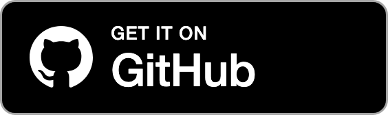</a>
</p>

<p align="center">
  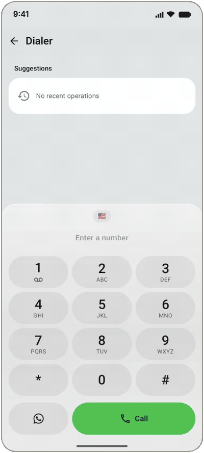
  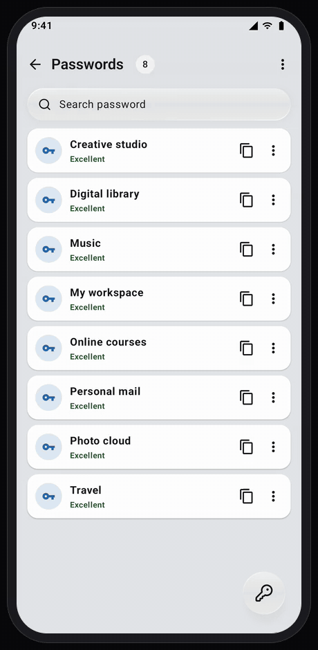
  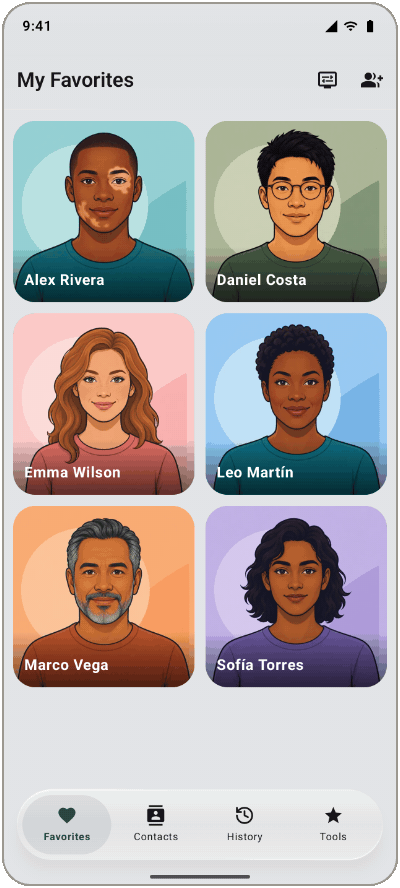
  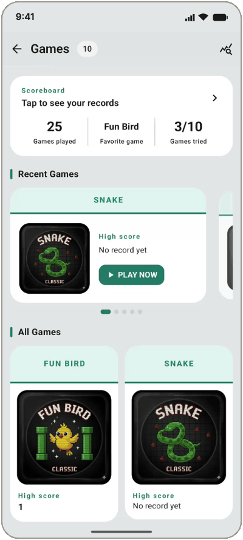
</p>

---

## Why Fun Phone

- **Private by design.** No ads, no analytics, no account and no developer cloud. Your contacts, notes and passwords stay on your phone.
- **A real phone app.** Fun Phone can replace the default dialer: T9 search, favorites, recents, call screening and in-call controls.
- **Only what you want.** Every extra tool can be shown or hidden, so the app stays as simple as you like.
- **Yours to shape.** Three visual styles, accent colors, 25+ fonts, text size, dark mode and adaptive glass effects.
- **Free software.** GPL-3.0-or-later, with a community build that contains no Google libraries and builds reproducibly.

## Screenshots

<p align="center">
  <a href="https://moncada25.github.io/fun-phone-web/#video">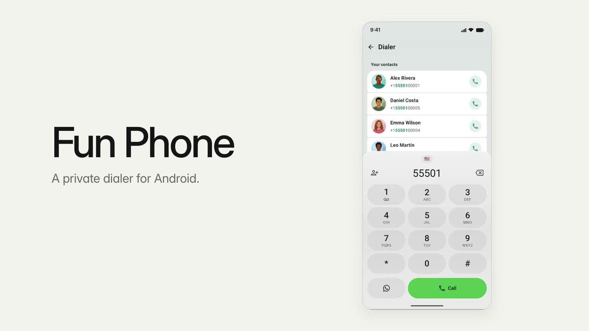</a><br>
  <a href="https://moncada25.github.io/fun-phone-web/#video">▶ Watch the 38-second tour</a>
</p>

| Dialer | Favorites | Calls | Notes |
|:---:|:---:|:---:|:---:|
| 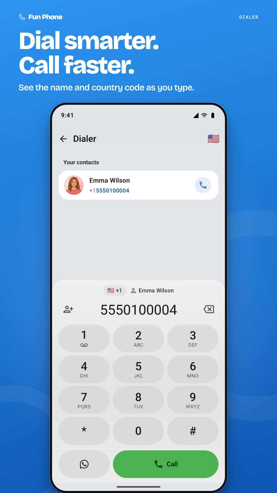 | 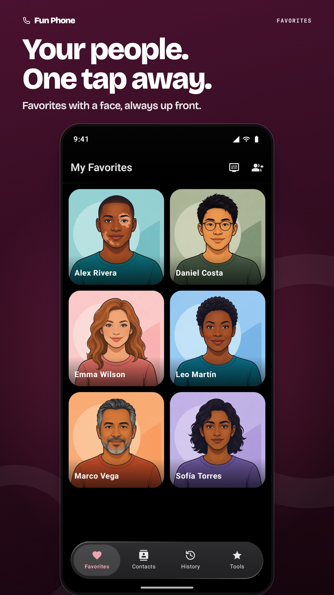 | 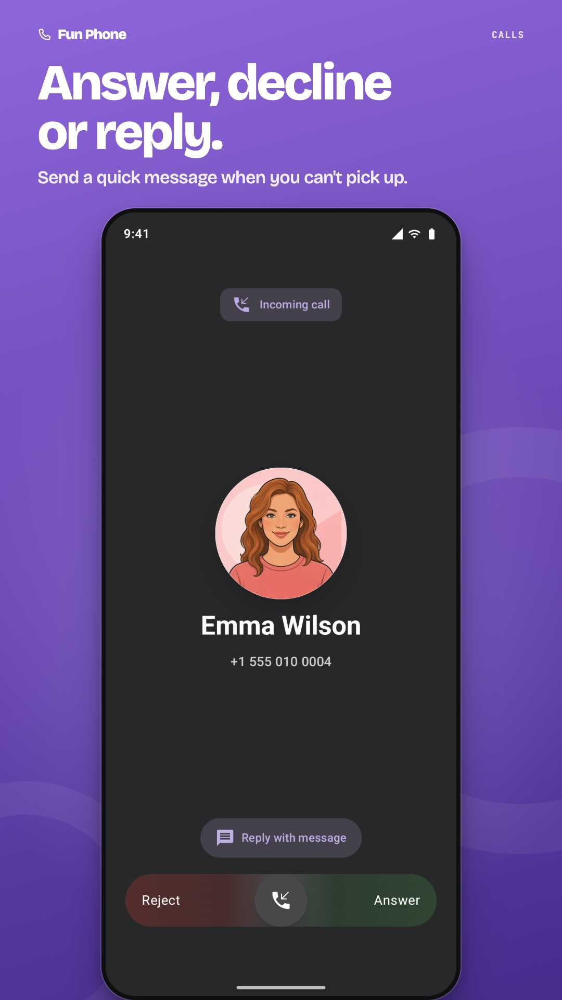 | 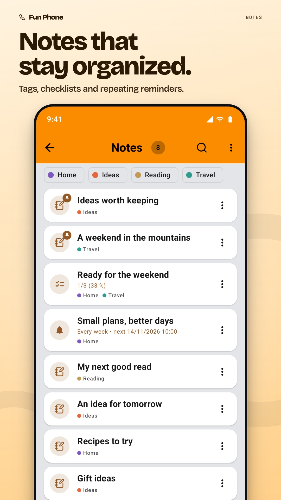 |
| **Vault** | **Expenses** | **Tools** | **Styles** |
| 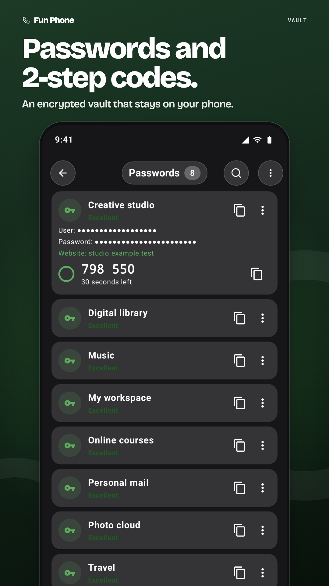 | 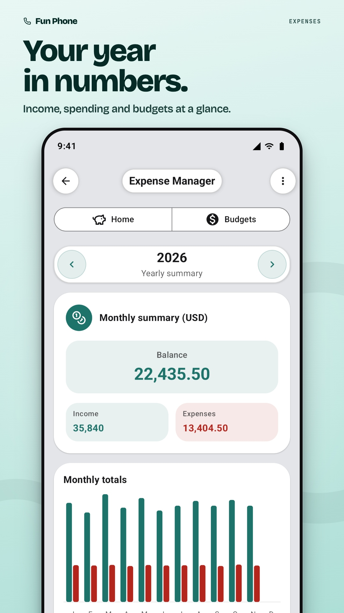 | 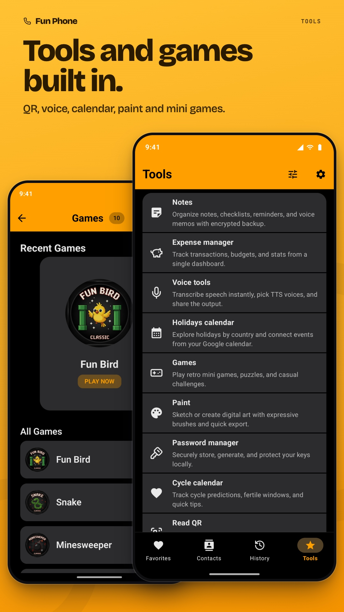 | 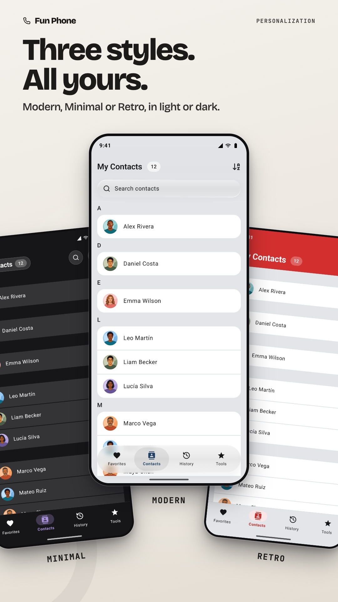 |

All screenshots use fictional demo data.

## Features

<details open>
<summary><b>Calls and contacts</b></summary>

- Default dialer with T9 search, favorites, recents and missed calls.
- Call screening and spam filtering on the device, blocked numbers and reply with a message.
- SIM choice, conference calls, hold, keypad tones, speaker and Bluetooth audio routing.
- Contacts from your Android accounts, with an alphabetical index, tags and favorites.
- vCard and JSON import/export, a duplicates finder, a recycle bin and contact QR codes.

</details>

<details>
<summary><b>Optional tools</b></summary>

- **Notes:** rich text, checklists, tags, images, global search, repeating reminders, voice recordings and a home screen widget.
- **Password vault:** encrypted with Tink and the Android Keystore, unlocked with PIN or biometrics, with a generator, two-step (TOTP) codes, reused-password warnings and system autofill.
- **Expenses:** transactions, budgets, monthly and yearly views, filters and CSV export.
- **QR:** scanner and generator, including Wi-Fi codes and reading from the gallery.
- **Voice:** speech to text and text to speech with your Android voices.
- **Calendar:** public holidays (optional, on request), contact birthdays and events from your device calendars.
- **Also:** Pomodoro timer, cycle tracking, a paint studio and 10 mini games (Fun Bird, Snake, Minesweeper, 2048, Puzzle, Tic Tac Toe, Hangman, Breakout, Sudoku and Memory Cards).

</details>

<details>
<summary><b>Customization and accessibility</b></summary>

- Modern, Minimal and Retro styles, in light and dark.
- Accent colors, 25+ fonts, text size, animations and vibration patterns.
- Adaptive glass effects that match your phone's performance.
- Labels and navigation designed for TalkBack and other accessibility services.
- Available in English, Spanish, German, French and Portuguese.

</details>

<details>
<summary><b>Your data</b></summary>

- Encrypted full backup that you export and keep, plus an app lock.
- Home screen widgets for favorites, recent calls, notes and expenses.
- App shortcuts for favorites, recents and the dialer.

</details>

## Download

| | Google Play | GitHub Releases | F-Droid |
|---|---|---|---|
| Package | `com.bookverse.contacts` | `com.bookverse.contacts.community` | `com.bookverse.contacts.community` |
| Google libraries | ML Kit (QR) and In-App Review | None | None |
| QR scanner | ML Kit | ZXing | ZXing |
| Updates | Google Play | [Obtainium](https://github.com/ImranR98/Obtainium) or manual | F-Droid client |
| Status | Available | Available | Planned for early 2027 |

The Google Play and community builds install side by side and don't share data. Use the in-app
backup to move your data between them.

### Verify the community APK

The community APK on GitHub Releases is signed with this certificate (SHA-256):

```
caf15843b5efc692ff6dec15e989d2fb32946dfc089453dfc6d31edf242b7151
```

Check it with [AppVerifier](https://github.com/soupslurpr/AppVerifier) or `apksigner verify --print-certs`.
The build is reproducible: building the release tag gives the same APK, byte for byte, once the
signature is applied. See [RELEASING.md](RELEASING.md).

## Privacy

Fun Phone has no ads, analytics, telemetry, account or developer cloud. It makes only two network
connections, and only when you ask for them:

1. **Public holidays** from [Nager.Date](https://date.nager.at), for the country and year you choose, after you approve it.
2. **Link previews** of a website or social profile you open.

Details: [PRIVACY.md](PRIVACY.md), [PRIVACY_DATA_FLOW.md](PRIVACY_DATA_FLOW.md) and [TELEMETRY.md](TELEMETRY.md).

## Build from source

You need JDK 25 and the Android SDK (API 37).

```bash
git clone https://github.com/Moncada25/fun-phone.git
cd fun-phone
./gradlew assembleCommunityDebug
```

The project is split into Gradle modules:

| Module | Contents |
|---|---|
| `:app` | The application: navigation, `AppContainer` (manual dependency injection), call screens, Telecom services, autofill and the manifest. |
| `:core:*` | `common`, `database` (Room), `datastore`, `designsystem` (theme and generic components), `security` (Tink, PIN and app lock) and `ui` (shared strings and components). |
| `:feature:*` | `contacts`, `dialer`, `notes`, `vault`, `expenses`, `qr`, `tools`, `games`, `settings` and `widgets`, each with its own screens, ViewModels and translated strings. |
| `:baselineprofile` | Baseline Profile generator and macrobenchmarks. |

Shared Gradle setup lives in the convention plugins under `build-logic/`. Architecture, Gradle
tasks, quality checks and CI are described in [docs/DEVELOPMENT.md](docs/DEVELOPMENT.md). Release
signing is in [SETUP.md](SETUP.md).

## Contributing

Bug reports, ideas, translations and pull requests are welcome.

- Read [CONTRIBUTING.md](CONTRIBUTING.md), including its policy on AI-assisted contributions.
- Report bugs and request features with the [issue templates](https://github.com/Moncada25/fun-phone/issues/new/choose).
- Ask questions and share ideas in [Discussions](https://github.com/Moncada25/fun-phone/discussions).
- Follow the [Code of Conduct](CODE_OF_CONDUCT.md).

## Security

Please report vulnerabilities privately as described in [SECURITY.md](SECURITY.md). Don't open a
public issue for them.

## License and trademark

Fun Phone is free software under the [GNU General Public License v3.0 or later](LICENSE)
(`GPL-3.0-or-later`). Copyright © 2026 Bookverse.

The license doesn't grant rights to the "Fun Phone" name, logo or icon. Modified versions must use a
different name, icon and `applicationId`. Unmodified redistributions, such as F-Droid or Obtainium,
may keep the original name. See [TRADEMARK.md](TRADEMARK.md).

## Acknowledgements

Fun Phone is built by Santiago Moncada (Bookverse) on top of great open source work, including
Jetpack Compose, Room, DataStore, CameraX, ZXing, Tink, Coil and
[Contacts, Reborn](https://github.com/vestrel00/contacts-android).
