# Fun Phone

<p align="center">
  <a href="LICENSE"></a>
  
</p>

<p align="center">
  <a href="https://play.google.com/store/apps/details?id=com.bookverse.contacts"></a>
  
  
  
  
  
</p>

> **Marcador y contactos privados y personalizables para Android**, con herramientas opcionales.
> Construida con Jetpack Compose + Material 3 y licenciada bajo **GPL v3**.

> Disponible en [Google Play](https://play.google.com/store/apps/details?id=com.bookverse.contacts).
> Las contribuciones son bienvenidas: lee [CONTRIBUTING.md](CONTRIBUTING.md) y propone ideas en
> [Discussions](https://github.com/Moncada25/fun-phone/discussions).

---

## 📚 Tabla de Contenidos

- [Descripción](#-descripción)
- [Características](#-características)
- [Capturas de Pantalla](#-capturas-de-pantalla)
- [Arquitectura y Stack](#-arquitectura-y-stack)
- [Requisitos del Entorno](#-requisitos-del-entorno)
- [Primeros Pasos](#-primeros-pasos)
- [Build y Calidad](#-build-y-calidad)
- [CI/CD](#-cicd)
- [Contribución](#-contribución)
- [Comunidad y Soporte](#-comunidad-y-soporte)
- [Seguridad y Privacidad](#-seguridad-y-privacidad)
- [Roadmap](#-roadmap)
- [Licencia y Marca](#-licencia-y-marca)
- [Documentación](#-documentación)
- [Agradecimientos](#-agradecimientos)

---

## 📝 Descripción

**Fun Phone** es una aplicación Android nativa, escrita **100% en Kotlin + Jetpack Compose + Material 3**, que unifica en una sola app:

- 📞 Un **marcador completo** que puede sustituir al dialer del sistema.
- 👤 Gestión de **contactos multi-cuenta** con búsqueda, favoritos, QR y anti-spam.
- 📝 Suite de **productividad**: notas con rich text/checklists/recordatorios/grabadora, gestor de contraseñas con cifrado Tink + biometría, gestor de gastos y Pomodoro.
- 🛠️ **Herramientas**: escáner y generador QR (CameraX + ZXing; el build `play` escanea con ML Kit), conversor de voz (STT/TTS), calendario local y estudio de pintura.
- 🎮 **10 mini juegos** en Compose: Fun Bird, Snake, Buscaminas, 2048, Puzzle, Tres en raya, Ahorcado, Breakout, Sudoku y Memory.
- 🎨 **Personalización profunda**: temas, paletas, fuentes, animaciones, vibración, widgets de favoritos, atajos de app.

Los datos principales (contactos, notas, contraseñas y grabaciones) se guardan localmente. Los
builds `community` y `play` no contienen Firebase, publicidad ni analítica. Las únicas conexiones
directas opcionales son la consulta de festivos a Nager.Date, tras una confirmación explícita, y la
vista previa social/web que el usuario solicita desde el selector de redes.
Consulta [PRIVACY.md](PRIVACY.md), [TELEMETRY.md](TELEMETRY.md), el
[inventario de flujos](PRIVACY_DATA_FLOW.md) y la hoja verificable de
[Data Safety](PLAY_DATA_SAFETY.md).

---

## ✨ Características

### 📞 Marcador y llamadas
- Marcador T9 con búsqueda rápida y nombres del Contacts Provider.
- Historial de llamadas segmentado con detección de spam.
- Soporte **Dual-SIM** con VoLTE.
- Contestación personalizable, modo silencio inteligente.
- Sensor de proximidad, enrutamiento de audio, DTMF, hold/swap, soporte Bluetooth.
- Servicios de llamada in-call (`FunPhoneInCallService`, `IncomingCallService`, `OngoingCallService`).
- Bloqueo de números vía AndroidX Contacts.
- **Default Dialer** completo con gestión de permisos en contexto.

### 👤 Contactos
- CRUD sobre Contacts Provider con sincronización con cuentas (Google/local).
- Búsqueda con índice alfabético y favoritos.
- Importar/exportar vCard y JSON.
- Compartir contactos y fotos como archivos locales mediante Android Sharesheet.
- QR de contacto (vCard + JSON).
- Anti-spam y deduplicación.

### 📝 Productividad
- **Notas**: rich text (richeditor-compose), checklists, recordatorios, adjuntos de audio, import/export JSON cifrado, recordatorios programables con WorkManager + AlarmManager.
- **Contraseñas**: vault cifrado con **Tink + Android Keystore**, acceso biométrico/PIN, generador, búsqueda en vivo.
- **Gastos**: gastos fijos y variables con estadísticas locales, import/export.
- **Pomodoro**: timer 25/5 configurable, sonidos, fondo.
- **Calendario menstrual**: registro en los datos locales de la app; el backup cloud está excluido
  y la transferencia directa entre dispositivos puede conservarlo.
- **Widget de favoritos** (Glance) con acciones rápidas.

### 🛠️ Herramientas
- **QR**: escáner (CameraX + ZXing en `community`, ML Kit en `play`) con zoom/foco/linterna, generador (ZXing), lectura desde galería, import de JSON o zipped backups.
- **Voz**: STT parcial, TTS con selector de voz, dictado, exportar transcripciones.
- **Calendario**: festivos, cumpleaños de contactos y consulta de eventos de calendarios conectados mediante el proveedor de calendario de Android.
- **Paint Studio**: pinceles, importar/exportar bitmaps, share.

### 🎮 Entretenimiento
- 10 mini juegos completos en Compose con ranking y stats.
- Sin micropagos ni tracking publicitario.

### 🎨 Personalización
- Temas claro/oscuro con detección del sistema.
- Paletas de acento, fuentes configurables (Bricolage Grotesque, Instrument Serif, JetBrains Mono).
- Animaciones, transiciones, vibración con patrones y duración.
- Estilo de barra de acento, grid de favoritos, atajos.

### 🌐 Extras
- Localización completa **ES/EN/PT/FR/DE** (5 idiomas).
- Onboarding guiado con permisos contextuales.
- App Shortcuts (Favoritos, Recientes, Marcador, Detalle de contacto).
- Deep links desde widgets y shortcuts.

---

## 📷 Capturas de Pantalla

Serie actual para web y Google Play, con capturas reales de Compose y datos ficticios.
Fuentes y exportación: [PLAY_STORE_LISTING.md](PLAY_STORE_LISTING.md#preview-assets--campaign-v3).
Google Play dispone de ocho imágenes y una portada para cada idioma: ES, EN, DE, FR y PT.
Los títulos y las descripciones corta y larga listos para copiar están en [play-listing/](play-listing/).
Vistas de campaña: [español](screenshots/store-v3/overview-es.jpg), [inglés](screenshots/store-v3/overview-en.jpg),
[alemán](screenshots/store-v3/overview-de.jpg), [francés](screenshots/store-v3/overview-fr.jpg) y
[portugués](screenshots/store-v3/overview-pt.jpg).

| Marcador | Favoritos | Llamadas | Notas |
|:---:|:---:|:---:|:---:|
| 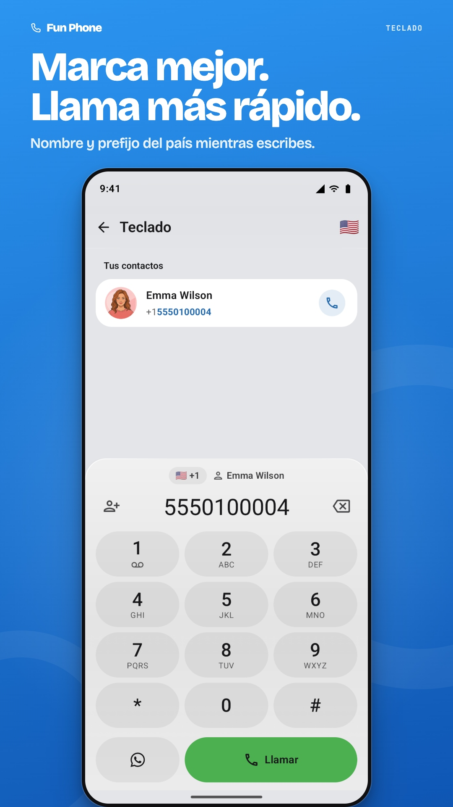 | 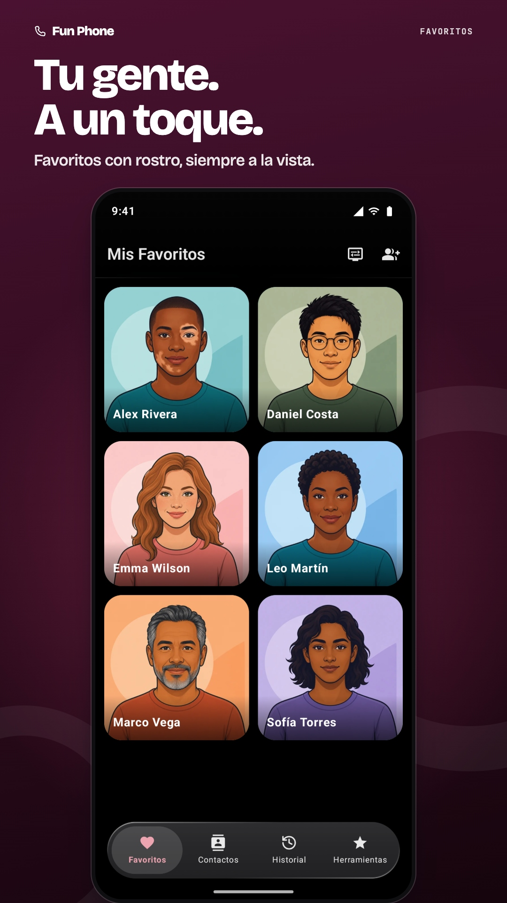 | 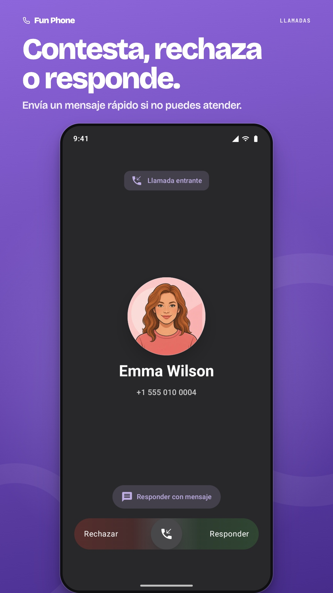 | 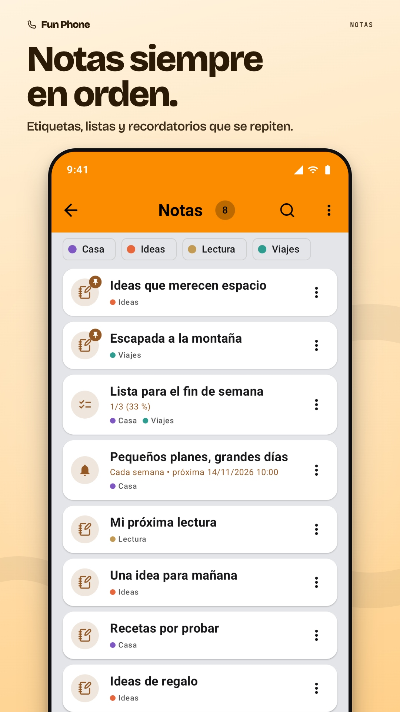 |

| Bóveda | Gastos | Herramientas | Personalización |
|:---:|:---:|:---:|:---:|
| 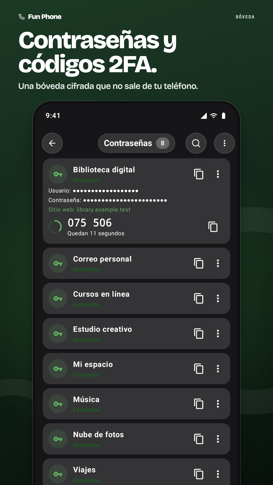 | 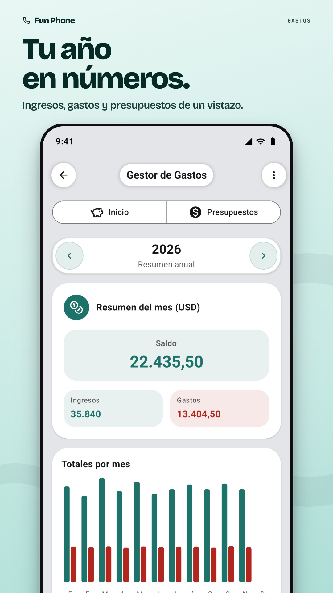 | 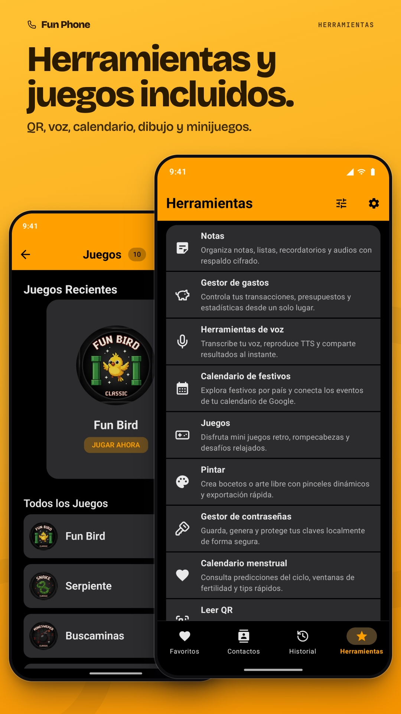 | 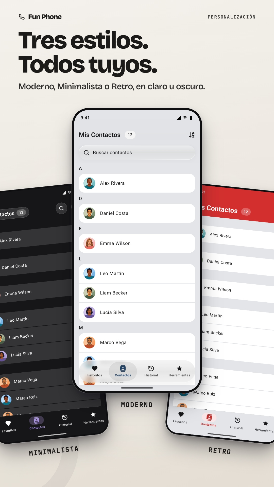 |

---:|:---:|:---:|:---:|
| 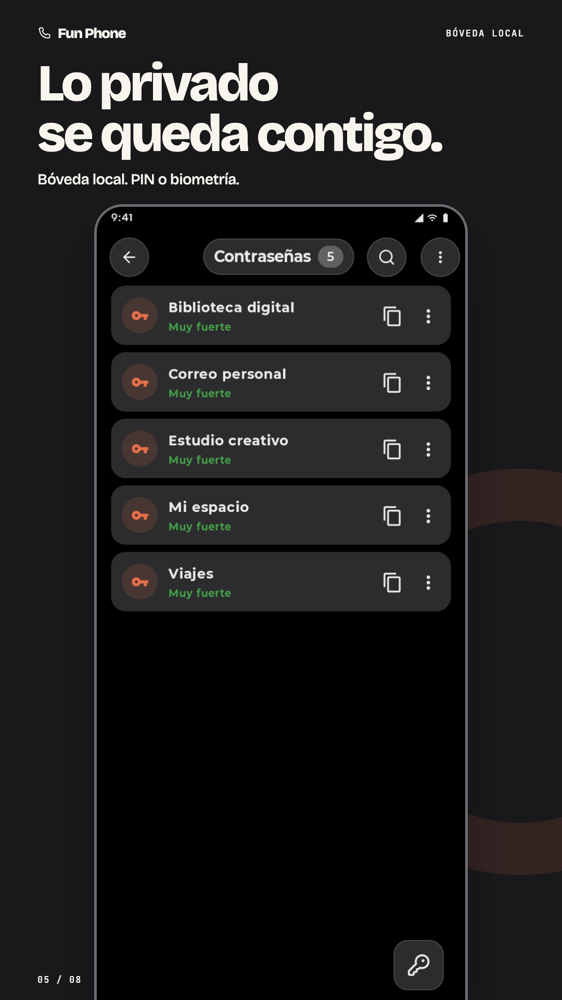 | 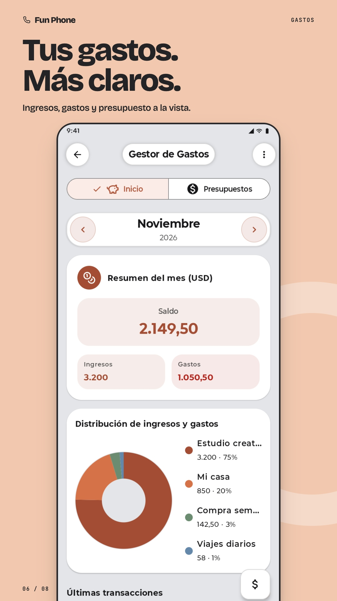 | 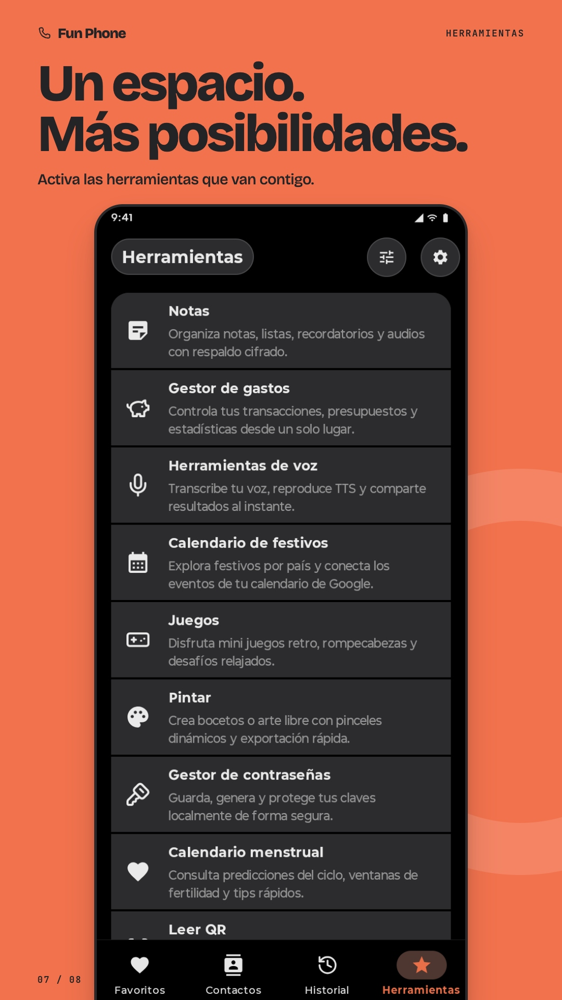 | 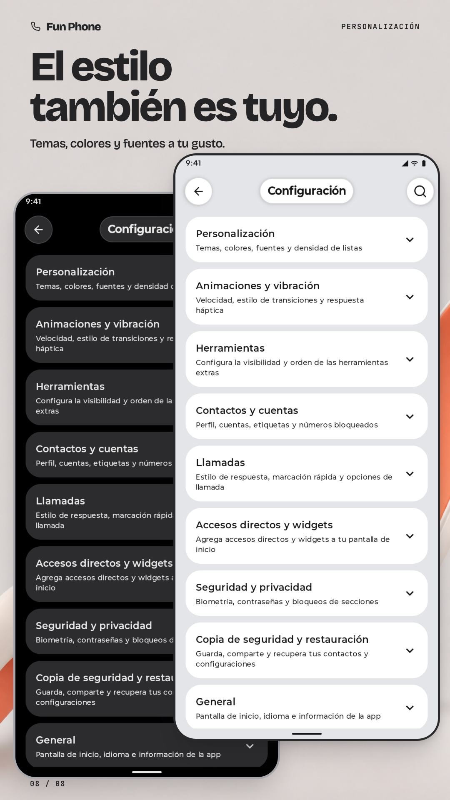 |

---

## 🏗️ Arquitectura y Stack

- **Tipo**: aplicación única (single-module), `app/`, package `com.bookverse.contacts`.
- **UI**: 100% **Jetpack Compose + Material 3**, sin XML layouts.
- **Arquitectura**: **MVVM + Repository Pattern**, flujos reactivos con `StateFlow` / `LiveData`.
- **Persistencia**: **Room 2.8.4** (KSP) con auto-migrations + **DataStore** (Preferences).
- **Async**: Kotlin **Coroutines** + Flow.
- **Servicios**: WorkManager, AlarmManager, Foreground Services (call/notifications).
- **Serialización**: Gson; los builds release limitan la red a festivos y a la vista previa social/web solicitada por el usuario.
- **Imágenes**: Coil (compose + svg) + Glance para widgets.
- **Cifrado**: **Google Tink 1.23.0** + Android Keystore + androidx.security-crypto.
- **Biometría**: androidx.biometric (huella/face) + PIN fallback.
- **Privacidad verificable**: sin Firebase, anuncios ni telemetría; las únicas conexiones directas
  opcionales son festivos y la vista previa social/web solicitada por el usuario. Play usa el
  cliente nativo de In-App Review.
- **Compatibilidad**:
  - `minSdk 29` (Android 10)
  - `targetSdk 37`
  - `compileSdk 37`
  - JVM target 25
  - Kotlin 2.3.21, AGP 9.3.1, KSP 2.3.9

<details>
<summary>Estructura principal</summary>

```
app/
 ├── src/main/java/com/bookverse/contacts/
 │    ├── App.kt / MainActivity.kt
 │    ├── data/          # Room, repositories, DAOs, workers
 │    │    ├── db/       # AppDatabase, DAOs, entities
 │    │    ├── notes/    # NoteDao, ChecklistItem, ReminderData, RecordingData
 │    │    ├── password/ # PasswordEntity, PasswordDao
 │    │    ├── repository/
 │    │    ├── service/  # ContactSyncWorker
 │    │    ├── hangman/  # Banco de palabras
│    │    ├── expenses/
 │    │    └── model/    # AppSettingsBackup
 │    ├── domain/        # Casos de uso y modelos de dominio
 │    ├── repository/    # Cache, profile, holidays, calendar
 │    ├── security/      # CryptoManager, AuthenticationManager
 │    ├── service/       # InCallService, IncomingCallService, OngoingCallService
 │    ├── settings/      # AppSettingsViewModel, Fonts, TransitionType
 │    ├── ui/
 │    │    ├── screens/  # contacts, calls, notes, passwords, games, qr, voice, holidays, extras, settings, expenses, onboarding, phone status, tools
 │    │    ├── components/
 │    │    ├── navigation/
 │    │    ├── state/
 │    │    ├── viewmodel/
 │    │    ├── theme/
 │    │    └── auth/     # Biometric dialogs
 │    ├── utils/         # NotesBackupUtils, adaptador local de fotos, ContactUtils, ...
 │    └── widget/        # Favorites Glance widget
 ├── src/main/res/       # Recursos, strings i18n (5 idiomas), drawables
 └── schemas/            # Esquemas Room exportados
```

</details>

---

## 🧰 Requisitos del Entorno

| Herramienta | Versión |
|-------------|---------|
| Android Studio | Ladybug (2024.2) o superior |
| JDK | 25 |
| Android SDK | API 37 (compileSdk) |
| Dispositivo / Emulador | API 29+ (minSdk 29 = Android 10) |
| Gradle | Wrapper incluido |
| Git | 2.x+ |

> 📌 Consulta **[SETUP.md](SETUP.md)** para configurar el SDK de Android y la firma release.

---

## 🚀 Primeros Pasos

```bash
# 1. Clona el repositorio
git clone https://github.com/Moncada25/fun-phone.git
cd fun-phone

# 2. Compila Community
./gradlew assembleCommunityDebug
```

> ⚠️ **Importante**: el `gradle.properties` tracked solo contiene opciones seguras. Mantén
> credenciales en variables de entorno, `local.properties`/`keystore.properties` o archivos privados
> ignorados. Los archivos heredados `google-services.json` también están ignorados y no se usan.

Abre el proyecto con Android Studio, selecciona el módulo `app` y ejecuta en un dispositivo/emulador con **Android 10 (API 29)** o superior.

### Firma de builds release

Gradle resuelve las credenciales en este orden:
1. Variables de entorno (`RELEASE_STORE_FILE`, `RELEASE_KEY_ALIAS`, etc.).
2. `local.properties`, `keystore.properties` o `gradle.properties.private` en la raíz.
3. `gradle.properties` (no recomendado).

> 📖 Instrucciones detalladas de signing, builds y permisos: **[SETUP.md](SETUP.md)**

---

## 🧪 Build y Calidad

| Script | Propósito |
|--------|-----------|
| `./gradlew assembleCommunityDebug` | Compila la distribución Community local-first. |
| `./gradlew testCommunityDebugUnitTest` | Ejecuta tests unitarios JVM de Community. |
| `./gradlew lintCommunityDebug lintPlayRelease` | Ejecuta lint para ambas variantes; CI verifica además un máximo de 20 warnings de actualización por variante. |
| `./gradlew ktlintCheck` | Detecta imports Kotlin sin usar (también se ejecuta en CI). |
| `./gradlew ktlintFormat` | Elimina automáticamente los imports Kotlin sin usar. |
| `./gradlew assemblePlayDebug` | Compila Play con In-App Review y sin Firebase. |
| `./gradlew bundlePlayRelease` | Genera el AAB oficial; requiere firma release. |
| `./gradlew preparePlayStoreArtifacts` | Genera y reúne AAB, mapping y símbolos Play; requiere firma release. |
| `./gradlew connectedCommunityDebugAndroidTest` | Ejecuta tests instrumentados Community en dispositivos conectados. |
| `./gradlew :app:generateReleaseManifest` | Genera versión, SDKs, distribuciones y capacidades desde `release.properties`. |
| `./scripts/verify-android-only.sh` | Rechaza módulos, plugins o targets KMP/iOS. |
| `./scripts/verify-telecom-contract.sh` | Protege el contrato de manifiesto del dialer/InCallService. |
| `./scripts/verify-feature-boundaries.sh` | Evita dependencias directas entre features ya aisladas. |
| `./scripts/verify-quality-contract.sh` | Protege matrices de calidad, pruebas críticas y tamaños de archivos de riesgo. |
| `./scripts/verify-release-metadata.sh` | Verifica que el manifiesto generado coincide con `release.properties`. |
| `./scripts/verify-play-release-notes.sh` | Valida y exporta las notas localizadas del candidato Play desde `CHANGELOG.md`. |
| `python3 scripts/test_play_release_notes.py` | Prueba el parser de notas Play y sus casos de rechazo. |
| `./scripts/verify-zero-collection.sh` | Verifica las rutas aprobadas de festivos y preview social/web, y rechaza AD_ID, Firebase, analítica y clientes con logging. |
| `./scripts/smoke-emulator-incoming-call.sh emulator-5556` | Simula una llamada solo en emulador y restaura el dialer anterior. |

### Estilo y buenas prácticas

- Kotlin oficial: **4 espacios**, **trailing commas** en listas multilínea.
- Componentes Compose en **PascalCase**, IDs/handlers en **camelCase**.
- Hoist del estado a ViewModels.
- Reutiliza componentes de `ui/components/` antes de crear nuevos.
- Para cambios en Room, regenera los esquemas en `app/schemas/`.
- Tests de UI en `app/src/androidTest/`. Detalles operativos en [AGENTS.md](AGENTS.md) y [CHEATSHEET.md](CHEATSHEET.md).

---

## 🔄 CI/CD

GitHub Actions en `.github/workflows/`:

| Workflow | Trigger | Qué hace |
|----------|---------|----------|
| **`android.yml`** | Push a `main` o ejecución manual | Compila Community, ejecuta tests/lint/guards y conserva diagnósticos solo ante fallos. |
| **`pr-checks.yml`** | Pull Request a `main` | Validación de calidad; conserva diagnósticos solo ante fallos. |
| **`secrets.yml`** | Push/PR a `main` | Escanea secretos nuevos sin depender de almacenamiento de artifacts. |
| **`play-release.yml`** | Ejecución manual desde `main` | Valida, firma y publica el AAB Play al 100% tras aprobación del environment `play-production`. |

Para sincronizar automáticamente la versión del landing privado, configura
`FUN_PHONE_WEB_DISPATCH_TOKEN` como fine-grained PAT limitado a `fun-phone-web`
con permiso **Contents: write**, necesario para enviar `repository_dispatch` a
`Moncada25/fun-phone-web`. Si no existe, Android CI continúa y omite únicamente esa notificación.

### Configurar releases automáticos

El workflow `play-release.yml` se ejecuta desde **Actions → Play Production Release → Run workflow**.
Antes de usarlo, crea el environment `play-production`, limita sus deployments a `main` y configura
aprobadores obligatorios. Registra allí estos secrets:

- `PLAY_UPLOAD_KEYSTORE_BASE64`
- `PLAY_KEYSTORE_PASSWORD`
- `PLAY_KEY_ALIAS`
- `PLAY_KEY_PASSWORD`
- `PLAY_SERVICE_ACCOUNT_JSON_BASE64`

La cuenta de servicio debe tener acceso de publicación para `com.bookverse.contacts` en Play Console.
El workflow lee la versión desde `release.properties` y las notas localizadas desde `CHANGELOG.md`;
no se escriben versiones ni notas manualmente en Play Console.

---

## 🤝 Contribución

¡Las contribuciones son bienvenidas! Lee primero:

- 📘 [CONTRIBUTING.md](CONTRIBUTING.md) — guía completa: setup, convenciones, PR.
- 📜 [CODE_OF_CONDUCT.md](CODE_OF_CONDUCT.md) — reglas de la comunidad.
- 🐛 [Issue templates](.github/ISSUE_TEMPLATE/) — para reportar bugs o proponer features.
- ✅ [PR template](.github/PULL_REQUEST_TEMPLATE.md) — checklist antes de abrir PR.

**Resumen rápido:**

1. Haz **fork** y crea una rama (`feature/mi-cambio` o `fix/mi-bug`).
2. Sigue las [convenciones de código](CONTRIBUTING.md).
3. Agrega/actualiza **strings en los 5 idiomas** (es/en/pt/fr/de).
4. Ejecuta `./gradlew assembleCommunityDebug testCommunityDebugUnitTest lintCommunityDebug lintPlayRelease`
   y `./scripts/verify-lint-ratchet.sh communityDebug playRelease`.
5. Abre un Pull Request usando la plantilla.

> 🛡️ **Identidad del proyecto**: el código está bajo GPL v3. No se afirma aquí que el nombre o
> logotipo tengan un registro formal; consulta [TRADEMARK.md](TRADEMARK.md).

---

## 💬 Comunidad y Soporte

| Canal | Uso |
|-------|-----|
| 🐛 [GitHub Issues](https://github.com/Moncada25/fun-phone/issues) | Bugs, features, preguntas técnicas. |
| 💬 [GitHub Discussions](https://github.com/Moncada25/fun-phone/discussions) | Ideas, propuestas, comunidad. |
| 📧 **Email** | `santiago.moncada.dev@gmail.com` (privado, sensible). |

---

## 🔐 Seguridad y Privacidad

- 🔒 **No subas secretos** al repo. Usa `local.properties` o env vars.
- 🛡️ **Vulnerabilidades**: reporte responsable vía [SECURITY.md](SECURITY.md) — **no abras un issue público**.
- 🔑 **Cifrado**: Tink 1.23.0 + Android Keystore para notas, contraseñas y respaldos locales.
- 👁️ **Política de privacidad**: ver [PRIVACY.md](PRIVACY.md) para el detalle completo.
- 🧪 El gate de release limita la red a Nager.Date y al preview social/web aprobado, y rechaza
  Firebase, telemetría, HTTP logging y AD_ID.

---

## 🗺️ Roadmap

El plan operativo y el estado de los próximos releases se mantienen en
[FUN_PHONE_PROGRESSIVE_RELEASE_SPEC.md](FUN_PHONE_PROGRESSIVE_RELEASE_SPEC.md). Ese documento es la
fuente de verdad para decidir qué entra en cada work package, qué PRs se agrupan para Play y qué
contratos permanecen congelados. Los PRs merged no generan una actualización individual para usuarios.

- ✅ Compose + Material 3 en toda la UI.
- ✅ Marcador completo + Default Dialer.
- ✅ Productivity suite (notas, contraseñas, gastos, pomodoro).
- ✅ 10 mini juegos Compose.
- ✅ 5 idiomas (es/en/pt/fr/de).
- ✅ Widget de favoritos.
- ✅ Código abierto en GitHub bajo GPL v3.
- ⏳ Colaboración opcional multi-dispositivo.
- ⏳ Mejoras continuas de accesibilidad (TalkBack, tamaños dinámicos).
- 🧠 Las propuestas se reciben en [GitHub Discussions](https://github.com/Moncada25/fun-phone/discussions).

---

## 📄 Licencia y Marca

Este proyecto se distribuye bajo la **[GNU General Public License v3.0](LICENSE)**.
Copyright (C) 2026 Bookverse.

Puedes usar, modificar y redistribuir bajo los términos de la GPL v3. Si distribuyes versiones
modificadas, **debes publicar el código fuente bajo la misma licencia**.

> El repositorio no aporta evidencia de un registro formal de marca. La licencia de cada asset y las
> pautas de atribución se describen en [TRADEMARK.md](TRADEMARK.md).

---

## 📚 Documentación

| Documento | Descripción |
|-----------|-------------|
| [AGENTS.md](AGENTS.md) | Handbook para AI agents: arquitectura, features, prácticas. |
| [DESIGN.md](DESIGN.md) | Sistema de diseño UI/UX y guía normativa para nuevas interfaces. |
| [FUN_PHONE_PROGRESSIVE_RELEASE_SPEC.md](FUN_PHONE_PROGRESSIVE_RELEASE_SPEC.md) | Fuente de verdad y checklist de releases progresivos. |
| [PRD.md](PRD.md) | Product Requirements Document detallado. |
| [CHEATSHEET.md](CHEATSHEET.md) | Comandos rápidos, ADB, debugging. |
| [SETUP.md](SETUP.md) | Setup paso a paso: SDK, signing, builds y permisos. |
| [CONTRIBUTING.md](CONTRIBUTING.md) | Guía de contribución. |
| [CODE_OF_CONDUCT.md](CODE_OF_CONDUCT.md) | Código de conducta. |
| [SECURITY.md](SECURITY.md) | Política de seguridad y reporte de vulnerabilidades. |
| [PRIVACY.md](PRIVACY.md) | Política de privacidad. |
| [PRIVACY_DATA_FLOW.md](PRIVACY_DATA_FLOW.md) | Inventario técnico de red, SDKs, retención y controles. |
| [PLAY_DATA_SAFETY.md](PLAY_DATA_SAFETY.md) | Borrador verificable para la declaración Data Safety de Play. |
| [PLAY_STORE_LISTING.md](PLAY_STORE_LISTING.md) | Copy fuente y orden seguro de screenshots para Play. |
| [TELEMETRY.md](TELEMETRY.md) | Política de cero telemetría y controles de release. |
| [TELECOM_REGRESSION_MATRIX.md](TELECOM_REGRESSION_MATRIX.md) | Matriz automatizada/manual y gate de release del dialer. |
| [QUALITY_RELEASE_GATES.md](QUALITY_RELEASE_GATES.md) | Gates de estado UI, pruebas, accesibilidad, rendimiento y layouts. |
| [TRADEMARK.md](TRADEMARK.md) | Política de marca. |
| [FOSS_PLAN.md](FOSS_PLAN.md) | Plan y directrices de la transición a Open Source. |
| [CHANGELOG.md](CHANGELOG.md) | Historial de versiones. |

---

## 🙌 Agradecimientos

- **Santiago Moncada · Bookverse** — diseño, desarrollo y dirección del proyecto.
- **Comunidad Jetpack Compose** — por las librerías, ejemplos e inspiración.
- **Contribuidores** que reportan bugs, proponen features y envían PRs.
- **Tink, Room, DataStore, CameraX, ML Kit, ZXing** y demás proyectos open source que hacen posible Fun Phone.

Los canales públicos de issues y contribuciones se habilitarán al publicar el repositorio limpio.
